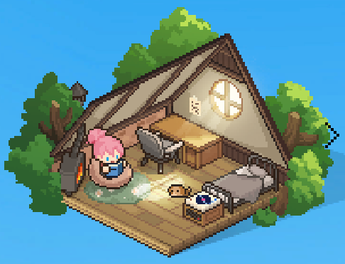
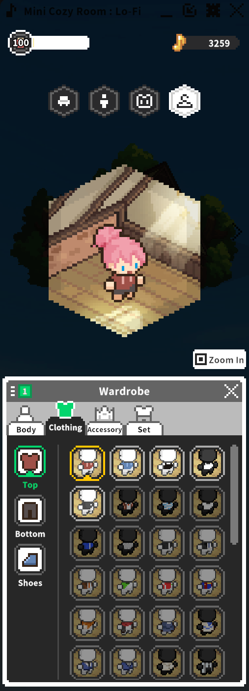

# A Cozy Little Workspace

During this semester, I found myself listening to a lot of Animal Crossing background music on  YouTube while I worked on my capstone project. I particularly enjoyed the cozy cafe settings featuring Animal Crossing characters reading books and drinking coffee or tea. Knowing how much I enjoyed these virtual environments, my friend suggested I check out Virtual Cottage. I decided to explore other similar games and came across Mini Cozy Room: Lo-Fi. I loved the idea of being able to create and customize my own virtual workspace with its cozy, pixelated aesthetic.

When I initially created my avatar, I noticed that many customization options were locked. I wasn’t sure whether I needed to purchase them or if they were unavailable because I was using the free Playtest version, which I assumed was something like a demo or beta. The workspace also had limited customization options. Although I didn’t have many choices, I still had fun previewing the different items on my avatar and in the room. Looking back, I think the application could have done a better job with discoverability by making it clearer how to unlock these items. At the time, though, I didn't think much of it since I was mainly interested in listening to music while working.

I then explored the Album button to the left of the playback controls, where I could listen to cafe jazz, Spotify, or even YouTube. I listened to some cafe jazz and music through the embedded YouTube feature before checking out the ambient sounds on the right side of the playback controls.

As I continued listening to music, I eventually discovered the rewards system through audible and visual notifications. Cardboard moving boxes appeared near the spinning record in the top-left corner of the window. Out of curiosity, I opened one of the boxes and received points. I soon realized that these points could be saved up and used to unlock the avatar and room customization items that were previously unavailable.

Until then, I had no idea how to unlock those items. Although the rewards system wasn’t immediately apparent to me, the notifications provided feedback that drew my attention to the boxes and encouraged me to interact with them. These notifications helped with visibility of system status by letting me know when rewards were available through both sound and visual cues. Through this interaction, I learned how the rewards system worked without needing instructions.

While working, I usually leave Mini Cozy Room alone and let the reward boxes accumulate. Occasionally, I’ll take a break to collect the boxes or see if I’ve earned enough points to unlock something I’ve been interested in. I don’t find these interruptions distracting since I can choose when to interact with the application. Instead, they’re like a nice little break from working on my capstone.

